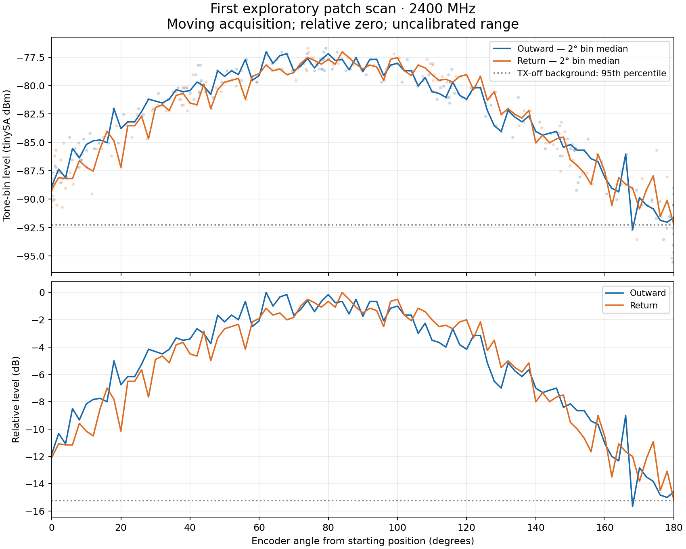

# First exploratory 2400 MHz patch scan — 2026-10-21

One 180-degree outward/return excursion was sampled while moving, using the
mounted 2.2/2.4 GHz patch as receiver. Relative 0 degrees is the starting mount
position, not an independently established boresight. The plot displays positive
excursion magnitude although the encoder counted negative on the outward leg.

## Setup and result

- LibreSDR B210mini TXRA, custom FPGA SHA256
  `7f0e329b4724e0d919a06b9924aaa3c77305b6f25038deebd6171657ac7c8a99`.
  UHD 4.6.0, subdevice A:A, gain 50, IQ amplitude 0.1, 1 MS/s; generated tone
  2400 MHz, LO 2399.9 MHz. Settings are not calibrated transmit power.
- 10 dB pad feeding the stationary log antenna; coax from rotating patch directly
  into tinySA Ultra RF. Range distance, height, source antenna model and exact
  patch revision were not recorded. Coax was attached during this motion test.
- tinySA4_v1.4-156-g4eb315d, Ultra mode, 30 kHz RBW, 10 dB internal attenuation,
  LNA off, calc off; 41 frequency points spanning 2399.5–2400.5 MHz.
- 177 outward and 179 return acquisitions passed analysis selection. Each took
  approximately 0.301 s. Encoder interpolation indicates up to 1.76 degrees of
  motion during one acquisition; software timing adds uncertainty. The graph
  uses 2-degree bin medians and shows individual samples faintly.
- Tone estimator: maximum of the three bins at 2399.975, 2400 and 2400.025 MHz.
  This excludes separately observed LO leakage at 2399.9 MHz. It is a tone-bin
  level estimator, not integrated channel power or calibrated antenna gain.
- Strongest binned tone reading: -77.03 dBm. TX-off baseline 95th percentile for
  the same estimator: -92.26 dBm, about 15.2 dB below the peak. No noise power
  subtraction was applied. Readings near this floor do not resolve deep nulls.
- All 91 two-degree bins have outward and return data. In 67 bins where BOTH
  traces exceeded the baseline by 6 dB, the median absolute difference was
  0.66 dB. The broad maximum is around 60–100 degrees from the starting position;
  small ripples and a precise peak angle are not independently validated.
- Encoder endpoint: -1199 counts (-179.85 degrees), home 0 counts; still 0 two
  seconds after disable. Fault=0, invalid encoder transitions=0. RF was stopped
  and the driver disabled after acquisition.

The preceding attempt stopped for absent encoder progress because the bench
motor supply was off. After the user enabled it, the fault was cleared and this
separate RF capture was made. The failed attempt is excluded from this plot.

## Interpretation limits

This is a first relative pattern-like range measurement. It includes the antenna,
polarization coupling, mount/coax, room reflections and instrumentation. It does
not establish absolute gain, circular polarization, radiation efficiency,
front-to-back ratio, angular accuracy or a full 3D pattern. The broadly similar
outward/return curves support short-term consistency, not free-space calibration.
The weak end of the trace reaches the measured background floor.

Raw RF/serial records remain in ignored private data. Versioned scripts and
Dockerfiles are in [tools/rf](../../tools/rf/README.md); numeric metrics are in
[summary.json](summary.json). No FPGA binary is included.
